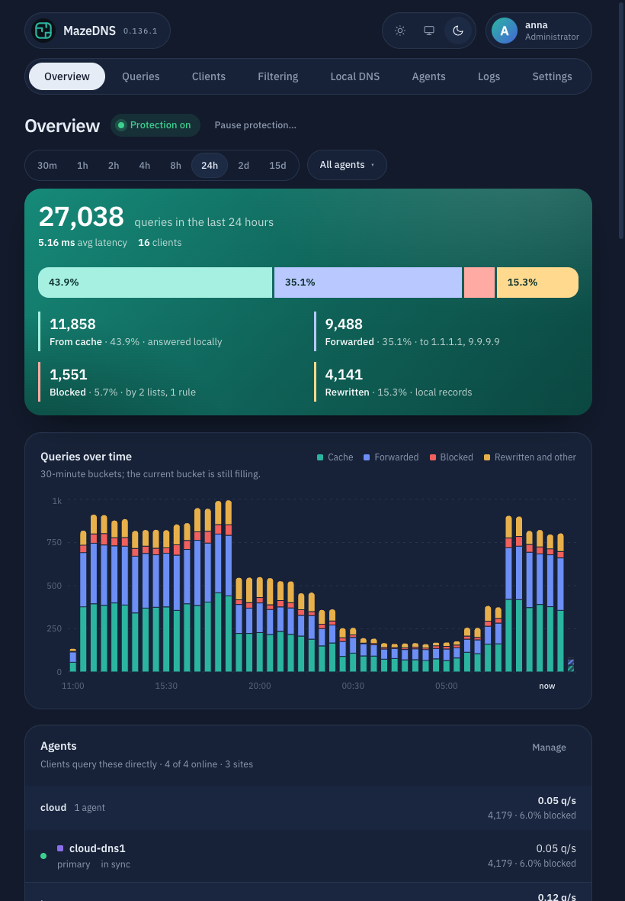
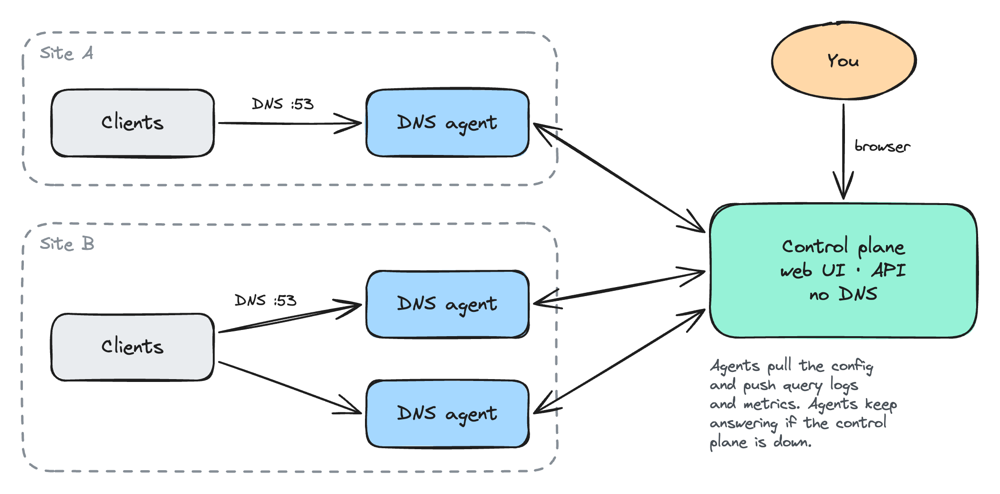

# MazeDNS

[](https://github.com/amaze-labs/MazeDNS/releases)
[](LICENSE)

A self-hosted **DNS filtering resolver**, like AdGuard Home or Pi-hole, built for
**several sites**: one control plane holds your configuration and dashboard, and
any number of DNS agents copy it and answer queries close to your clients.


## What it does

### See what your network does

Every query from every agent lands in one place: how it was answered (cache,
upstream, blocked, local record), by which agent, for which device, and **what
kind of traffic it is**: social, streaming, work, gaming… Devices get names, and
each one has its own breakdown.

| Queries | A client |
|---|---|
|  |  |

### Filter it

Blocklists from a URL, a file or pasted text, your own allow and block rules,
**whole categories** (adult, gambling, social…) blocked on every agent, and a
one-click pause.


### Classify new domains: traffic type and risk

Classification answers two questions about every domain your network uses:

- **What it is.** Every query is labelled with its traffic type from local data:
  your corrections, a 5-million-domain category database, a built-in list of
  common platforms, and optionally an AI model.
- **Whether it's safe.** Newly seen domains get a 0–100 legitimacy score from the
  signals you choose (threat feeds, WHOIS age, reputation services, the shape of
  the name, an optional AI model). Risky ones wait for your review or are
  blocked automatically. **Nothing is sent to a third party unless you turn it
  on**, and your own domains can be kept out entirely.

| Review | Why a domain scored low |
|---|---|
|  |  |

### Answer your own names

Local records (`nas.home.lan`, `*.lab.home.lan`) with reverse lookups for free,
conditional forwarding (`corp.internal` → your office DNS), each scoped to every
agent, a site, or a single agent for split-horizon answers.


### Run it on several sites

Agents enroll themselves with a key, copy the configuration, and keep answering
from their last copy if the control plane goes away. Group them into sites with
a role each, put one in maintenance to drain it, and see at a glance which
agents are healthy, in sync and up to date.


### And everything around it

- **DNS:** DoT and DoH, both as a server and to upstreams, with ordered or
  hedged upstreams. DNSSEC-transparent forwarding, authoritative zones, a cache,
  per-client rate limits.
- **Accounts:** local users or single sign-on through any **OIDC** provider,
  profile pictures, and API tokens for integrations.
- **Observability:** Prometheus `/metrics` on both components, optional
  VictoriaMetrics and VictoriaLogs export, and a Logs page for every agent.
- **Updates:** Settings → About & updates shows when a new release is out, and
  what it changes.
- **Everywhere:** light, dark or system theme, and a layout made for phones and
  tablets.

| Phone | Tablet, dark |
|---|---|
|  |  |

## How it runs

MazeDNS is two containers:

<picture>
  <source media="(prefers-color-scheme: dark)" srcset="docs/images/architecture-dark.png">
  
</picture>

<sub>Drawn with Excalidraw: open <a href="docs/images/architecture.excalidraw">architecture.excalidraw</a> on excalidraw.com to edit it.</sub>

| Image | Serves | Run |
|-------|--------|-----|
| `ghcr.io/amaze-labs/mazedns-control-plane` | web UI, API, `/metrics` (**no DNS**) | **one**, on the host you manage |
| `ghcr.io/amaze-labs/mazedns-agent` | DNS (UDP/TCP, optionally DoT/DoH), `/healthz`, `/readyz`, `/metrics` | **one or more**, wherever you serve DNS |

Clients point at the **agents**. Agents keep resolving from their local copy even
if the control plane is down for a while, and the dashboard's load never touches
the DNS path.

## Fast deploy (Docker Compose)

```bash
# 1. Get the compose file.
curl -O https://raw.githubusercontent.com/amaze-labs/MazeDNS/main/docker-compose.prod.yml

# 2. Tell the agent where to reach the control plane. The compose file requires this
#    (host networking has no Docker DNS); on a single host it's this host's LAN IP.
echo 'MAZEDNS_CP_IP=192.168.1.10' > .env

# 3. Bring up the control plane, then open http://localhost:8080 and complete the
#    setup wizard (create your admin or configure SSO, then create an enrollment key).
#    There is no admin password env var and no setup token: the first visitor owns
#    setup, so don't expose 8080 publicly until the wizard is done.
docker compose -f docker-compose.prod.yml up -d control-plane

# 4. Add the enrollment key the wizard gave you, then start the agent:
echo "MAZEDNS_JOIN_TOKEN=<enrollment-key>" >> .env
docker compose -f docker-compose.prod.yml up -d
```

This runs a control plane (dashboard on `http://localhost:8080`) and one DNS agent
listening on `:53`. Sign in with the admin account you created, then point a client
at the agent:

```bash
dig @<agent-host> example.com        # resolves
dig @<agent-host> doubleclick.net    # blocked, once you add a blocklist
```

The full walkthrough (Docker, Kubernetes, `network_mode: host`, pinning the control
plane's IP) is in **[docs/install.md](docs/install.md)**.

## Documentation

Start at the **[documentation index](docs/README.md)**.

- **[Install](docs/install.md):** Docker/Compose and Kubernetes.
- **[User guide](docs/user-guide.md):** a tour of every page, with screenshots.
- **[Configuration](docs/configuration.md):** every `MAZEDNS_*` variable and YAML setting.
- **[Troubleshooting](docs/troubleshooting.md):** symptom → fix.
- **[Developer docs](docs/dev/README.md):** building from source and internals.

## Security notes

- Never expose the control-plane UI/API to the internet: keep it on a management
  network or VPN, behind a TLS reverse proxy.
- The agent's `/metrics`, `/healthz` and `/readyz` endpoints are unauthenticated:
  bind them to a private address (they default to loopback).
- **The resolver has no client ACL**: anything that can reach an agent's `:53`
  gets answers. Keep agents on a private network or firewall the port; never
  publish `:53` to the internet.
- Per-client rate limiting is available but ships **disabled**: turn it on under
  **Settings → Resolver** (queries per minute per client IP; `REFUSED` beyond).
- Classification contacts nothing outside until you choose the services it may
  use; see [Classification](docs/user-guide.md#classification-traffic-types-and-risk).

## License

Copyright © 2026 Amaze Labs

MazeDNS is free software, licensed under the **GNU Affero General Public License
v3.0 or later**; see [LICENSE](LICENSE).

You can run, modify and self-host it freely. The AGPL's network clause means that
if you offer a modified MazeDNS to others over a network, as a hosted or managed
service, you must also offer those users the source of your modified version.
