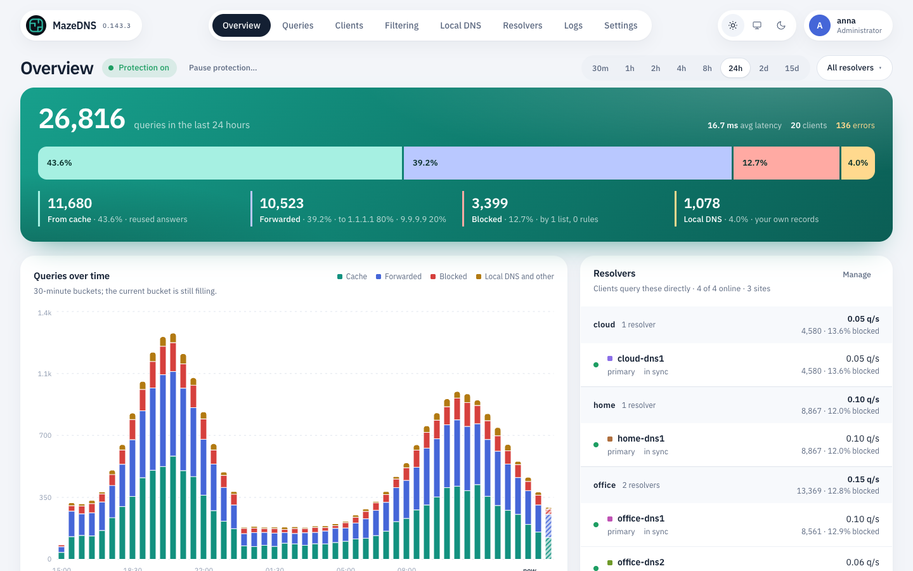
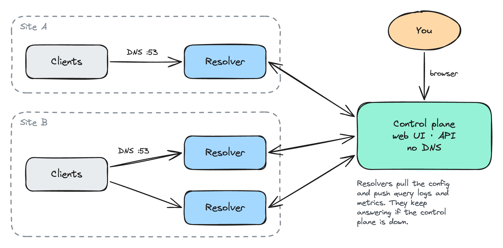

# MazeDNS documentation

MazeDNS runs as two containers: a **control plane** (web UI, API, config — no DNS)
and one or more **DNS resolvers** (the DNS servers your clients query). Everything below
is written for deploying and operating those containers — no source builds required.

## Terms

- **Control plane**: the web UI, API and configuration store. It answers no DNS.
- **Resolver**: a MazeDNS DNS server your clients query. The API and config call
  each one a *node* (`/api/cluster/nodes`, `MAZEDNS_NODE_KEY`). Earlier releases
  called resolvers *agents*; the old image and binary names still work for now
  (see [Renamed artifacts](install.md#renamed-artifacts)).
- **Upstream**: a DNS server outside MazeDNS (Cloudflare, Quad9, your router…) that
  resolvers forward queries to. Set under **Settings → Resolver → Upstream servers**.

## For operators

- **[Install](install.md)** — deploy with Docker/Compose (fast deploy first) or
  Kubernetes.
- **[Configuration](configuration.md)** — the authoritative reference for every
  `MAZEDNS_*` environment variable and YAML setting, split by control plane / resolver /
  shared.
- **[User guide](user-guide.md)** — the dashboard, blocklists and rules, rewrites
  and local records, running a cluster, authentication and SSO, and backup/restore.
- **[Troubleshooting](troubleshooting.md)** — symptom → fix, using `docker`,
  `kubectl`, and `dig` only.

## Concepts at a glance

<picture>
  <source media="(prefers-color-scheme: dark)" srcset="images/architecture-dark.png">
  
</picture>

- **Control plane** — holds the config and dashboard, coordinates the cluster,
  never answers DNS. Run one.
- **DNS resolver** — serves DNS and replicates its filtering config from the control
  plane. Run one or more. Clients point here.
- **Enrollment** — resolvers self-register with an **enrollment key** (created in the UI,
  passed as `MAZEDNS_JOIN_TOKEN`) and receive a per-node key automatically; they then
  appear on the **Resolvers** page.
- **Bootstrap vs. operational settings** — the database, HTTP/DNS bind addresses &
  ports, TLS, and log level are read from env/YAML on every start; everything else on
  the control plane (auth/SSO, cluster policy, DNS defaults, cache, rate limits, block
  behavior, classifier, metrics) is seeded once and then edited live in the UI.

## For developers

Building from source, repo layout, and internals live under **[docs/dev/](dev/README.md)**:

- **[Development](dev/development.md)** — prerequisites, repo layout, `make` targets,
  running locally, tests, benchmarks, and the two-image Dockerfile.
- **[Architecture](dev/architecture.md)** — components, query pipeline, data model,
  clustering protocol.
- **[Latency audit](dev/latency-audit.md)** — resolver hot-path performance work.
- **[Improvement plan](dev/improvement-plan.md)** and **[Roadmap](dev/roadmap.md)**.
