# User guide

Everything you do day-to-day happens in the **control-plane web UI** (default
`http://<control-plane-host>:8080`). The control plane holds all config; agents
replicate it automatically. You never edit files on an agent.

- [Overview](#overview)
- [Queries and clients](#queries-and-clients)
- [Query privacy](#query-privacy)
- [Upstreams, cache, and DNS behavior](#upstreams-cache-and-dns-behavior)
- [Blocklists and allow/deny rules](#blocklists-and-allowdeny-rules)
- [Domain categories](#domain-categories)
- [Classification: traffic types and risk](#classification-traffic-types-and-risk)
- [Local DNS: local records](#local-dns-local-records)
- [Client names](#client-names)
- [Pause blocking](#pause-blocking)
- [Clustering operations](#clustering-operations)
- [Authentication and SSO](#authentication-and-sso)
- [Your account, profile picture and theme](#your-account-profile-picture-and-theme)
- [API tokens](#api-tokens)
- [Backup and restore](#backup-and-restore)
- [About and updates](#about-and-updates)
- [On a phone or tablet](#on-a-phone-or-tablet)
- [Seeing real client IPs](#seeing-real-client-ips)

---

## Overview

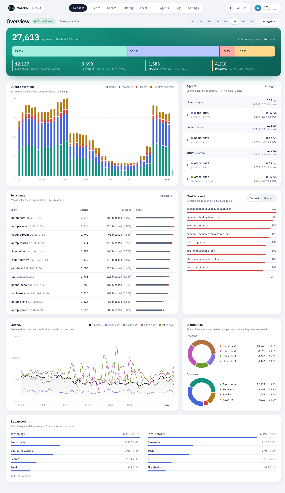

**Overview** is the home page. Pick a time window (30 minutes → 15 days) and an
agent at the top; everything below follows it:

- the total queries, average latency and clients, and how the queries were
  answered: from cache, forwarded upstream, blocked or rewritten by a local record;
- **Queries over time**, with the same split;
- **Agents**: every agent grouped by site, online or not, in sync or not, with its
  load and block rate;
- **By category**: what the traffic is (social, streaming, work…). Pick a
  category to open its queries;
- the top domains, top blocked domains and the busiest clients.

The **Protection on** badge and **Pause protection…** next to the title are the
[pause control](#pause-blocking).

## Queries and clients

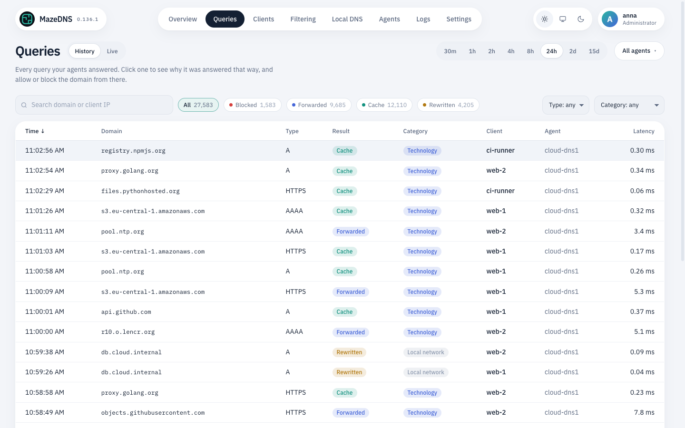

**Queries** lists individual queries. Filter by agent or site, client, domain,
type, action, category and response code, and sort by processing time (`ms`) to
find slow lookups. Click a row for its details: how it was answered, by which
agent and upstream, and the domain's category, which you can **Change** from
there.

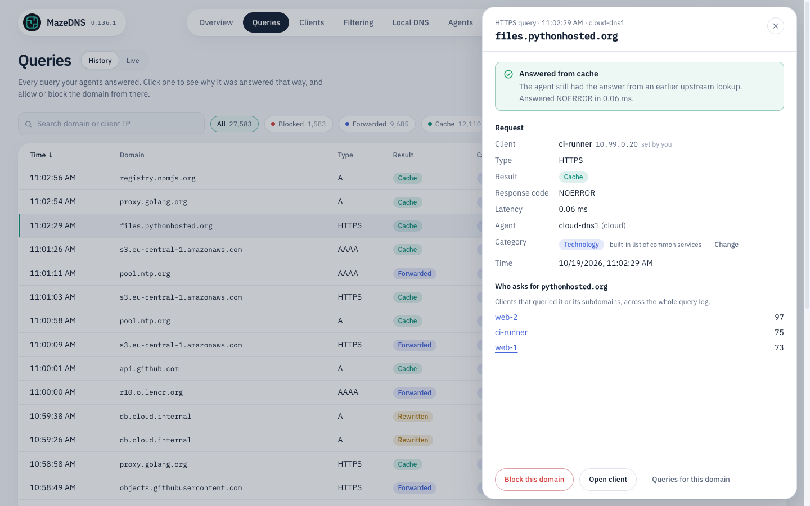

Switch the Queries page to **Live** to watch queries as the agents answer them
(within about a second), newest first — e.g. while debugging a client or checking
that a new block rule takes effect. Filter by node or site, client (IP or resolved
name), domain, type, action, classification, and rcode; blocked and rewritten
queries are highlighted, and clicking a row opens the client's details. The
browser keeps the last 1000 rows, and the stream pauses while the tab is hidden.
Agents only send queries while someone is watching them, and only the ones that
match the filters. Live is best effort (a slow view drops rows); the stored query
log is unaffected.

**Clients** lists every device that queried an agent, with its name (see
[Client names](#client-names)), volume and block rate. Open one to see what it
uses, per category, and its top and blocked domains; you can give it a name
there.

| Clients | A client |
|---|---|
| 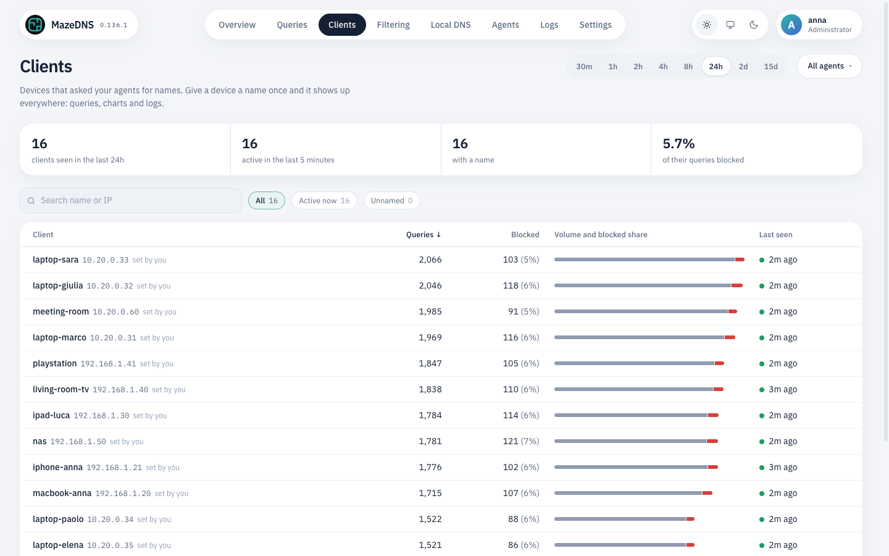 | 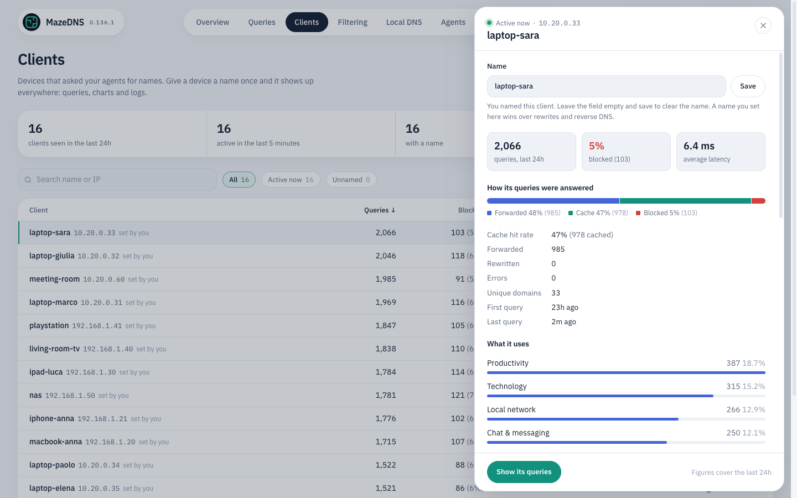 |

## Query privacy

**Settings → Resolver → Privacy** limits what MazeDNS keeps about each query.
The levels are Pi-hole's, applied cluster-wide:

| Level | What is kept |
|---|---|
| **Show everything** (default) | Every query with its client and domain. |
| **Hide domains** | Domains are stored as `hidden`; clients are kept. |
| **Hide domains and clients** | Domains are hidden and each client becomes a pseudonym such as `anon-3f9a2c1b7e`. |
| **Anonymous (counts only)** | No query is kept, only the dashboard counts (totals, actions, content categories). |

Filtering never changes: blocking, rate limiting, the cache and local records
always use the real client and domain. Only what is stored, shown (Queries,
Clients, Live, a client's details) and exported to VictoriaLogs is reduced.

- **Pseudonyms.** A device keeps the same pseudonym for one UTC day, so top
  clients and per-client block rates still work. Each day uses a new random key
  that is deleted once the day is past the detail window, after which nobody,
  you included, can tell which address a pseudonym stood for or link it to
  another day. Unique-client counts over several days therefore count a device
  once per day.
- **Hide only rare domains (k-anonymity).** With either "hide" level you can
  choose **Domains to hide: visited by fewer than k devices** instead of all of
  them. A domain is kept when at least *k* different devices queried it that
  UTC day or the day before; a rarer one is hidden, because a domain only one
  or two devices visit (a personal site, a clinic, a small employer) can point
  to a person. When a name is rare but its registered domain is common, the
  registered domain is kept instead (`u123.tracker.com` → `tracker.com`).
  Devices are counted by their daily pseudonym, in memory, never by address.
  A domain's first queries of the day can be hidden before it reaches *k*.
- **Classification keeps working.** Each domain is labelled with its content
  category and handed to the classifier as it arrives, before it is hidden.
- **Keep full detail for.** Optionally, queries keep full detail for a few hours
  (up to 7 days) for troubleshooting, then the level applies to them. Exports
  to VictoriaLogs always get the reduced data, whatever this window.
- **Changing the level.** Raising it also applies it to the history already
  stored (within a minute). Lowering it applies to new queries only: what was
  hidden cannot be brought back.
- **Agents** delete their local copy of each query once it has been sent to
  the control plane, and their `query` process-log lines leave out what the
  level hides.

## Upstreams, cache, and DNS behavior

Operational DNS settings live under **Settings** and apply live across the cluster
(no restart): every agent picks them up on its next config poll, and they override
the agent's own settings. An agent keeps its local settings until its first
successful sync, and keeps the last synced ones if the control plane is unreachable.
Agents older than the control plane ignore replicated settings until upgraded.

> **Upgrading:** before replicated settings, agents ignored this page and ran the
> settings seeded from their own config file. After upgrading, the control plane's
> settings replace them on every agent, so check this page (e.g. the upstreams)
> before rolling the upgrade out.

- **Upstream resolvers** — plain (`1.1.1.1:53`), DoT
  (`tls://1.1.1.1:853#cloudflare-dns.com`), or DoH (`https://dns.quad9.net/dns-query`).
  Quick-fill buttons are provided; use the ↑/↓ arrows on each row to set the order,
  which is saved exactly as shown. With the default **Ordered** strategy every query
  goes to the first resolver and the next one is tried only if it times out (the
  **per-resolver timeout**, default 1500 ms), fails, or answers `SERVFAIL`/`REFUSED`
  — never in parallel. **Hedged** instead races the remaining resolvers when the first
  hasn't answered within 30 ms, for lowest latency. Conditional forwarders with
  several upstreams follow the same strategy. See
  [Upstream strategy](configuration.md#upstream-strategy).
- **Conditional forwarders** — send a domain suffix to specific upstreams
  (split-horizon), e.g. `corp.internal` → your internal resolver. Each entry can
  be scoped to every agent, specific sites or specific agents, can be switched off,
  and is pushed to the agents automatically, overriding a node's own (YAML-seeded)
  forwarder for the same suffix. Changes here apply at once, without **Save**.
  Older versions also kept a separate list of forwarders on the control plane
  itself; the control plane answers no queries, so those never applied. If any
  are left, the section offers to move them to the list (a domain the list
  already forwards keeps its entry) or to remove them.
- **Cache** — enable/size it and clamp TTLs (`min_ttl`/`max_ttl`).
- **Rate limit** — per-client queries per minute (`REFUSED` beyond).
- **DNSSEC** — force the DO bit upstream and surface the AD flag.
- **Block response** — `nxdomain` (default) or `zeroip` (`0.0.0.0` / `::`).

The config file only *seeds* these on first run; afterwards the database is the
source of truth and the file is ignored for them. On an agent in a cluster, the
control plane's settings take precedence over both.

## Blocklists and allow/deny rules

Manage blocking from the UI:

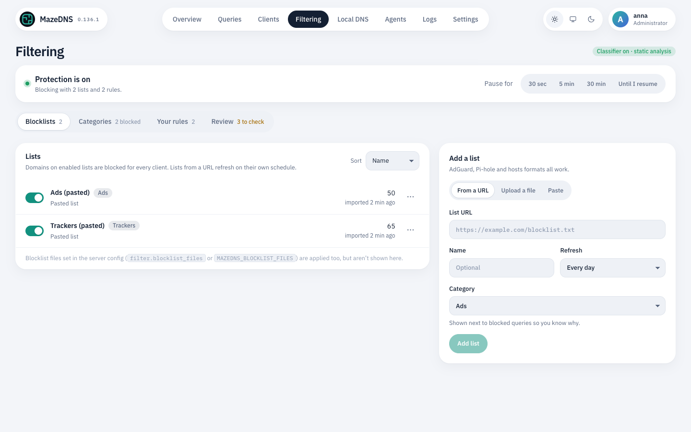

- **Blocklists** — add lists from a file, pasted text, or a remote URL with
  scheduled auto-refresh. Enable/disable each independently, view entry counts, and
  remove them. Entries are tagged with their **list source** (not lumped into
  `custom`), so category stats stay meaningful.
- **Rules** — explicit **deny** (block a domain and its subdomains) or **allow**
  (exempt a domain from blocking). Allow wins over block.

A domain blocked by a list or a deny rule returns your configured block response.
Agents pick up changes automatically on their next sync.

File-based blocklists mounted into an agent (`MAZEDNS_BLOCKLIST_FILES`) are loaded
**locally** on that agent and are not replicated — mount them on every agent that
should use them.

## Domain categories

Every query is labelled with what its domain is — social, streaming, shopping,
news, gambling, adult, ads and about twenty more — independently of which
blocklists you use. A domain's category comes from the first source that knows
it:

1. **Your override** — set it from a query's details or a domain's review drawer
   (**Change**, for the whole registered domain); **Use automatic** removes it.
2. **Local network** — a query answered by one of your local records, and names
   that only exist inside a network (reverse lookups, `.lan`, `.home.arpa`,
   `.internal`, single-label hostnames).
3. **The classifier**, when it is blocking the domain (phishing, malware, …).
4. **The category database**: [UT1](https://dsi.ut-capitole.fr/blacklists/),
   published by Université Toulouse Capitole (CC BY-SA 4.0), about 5 million
   domains. The control plane downloads it next to its database and refreshes it
   daily.
5. **The built-in list** of the platforms behind most everyday traffic that the
   database doesn't list: operating-system and cloud services (Apple, Microsoft,
   Google), CDNs, the big streaming, social, messaging and productivity apps.
6. **The language model**, if one is configured, for domains neither knows
   (including trusted ones, which skip scoring). Domains scored before
   categories existed are labelled gradually in the background.
7. **Other**, when nothing knows the domain.

A query is labelled when it arrives. Queries from the last 7 days still in
**Other** are labelled again every few minutes, so they move once their domain
gets a category. Without a language model, what stays in Other is mostly
smaller sites neither the database nor the built-in list knows.

Where you see them:

- **Queries** — a Category column and filter (the filter matches what the domain
  was when the query was logged; queries logged before categories have none).
- **Overview → By category** — query volume per category for the window. Pick
  one to open its queries.
- **Clients** — what each device uses, per category.

### Block by category

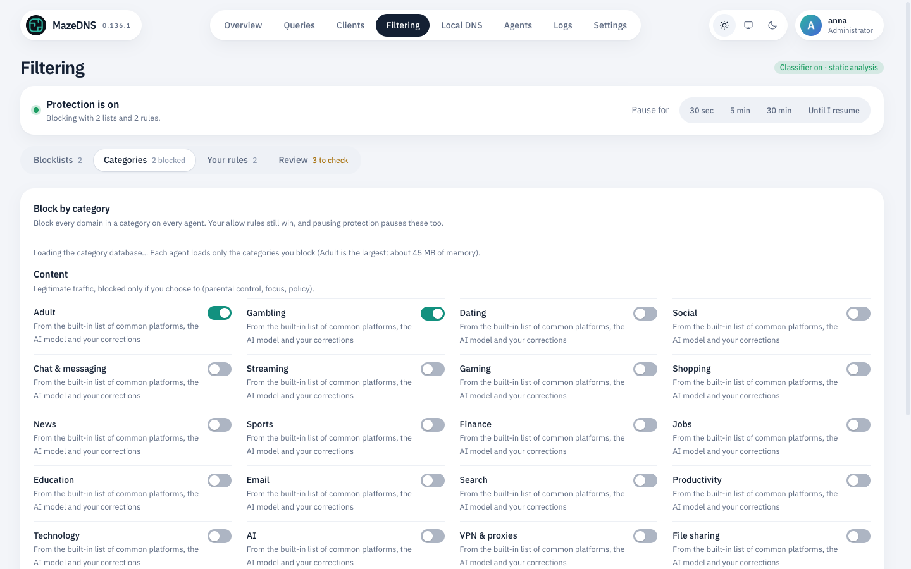

**Filtering → Categories** blocks whole categories on every agent (parental
control, a focus policy). Each agent downloads the category database for just
the categories you block — Adult is the largest at about 45 MB of memory, most
are under 1 MB — and nothing while none is blocked. Your allow rules still win,
and pausing protection pauses category blocks too. Your overrides and the
language model's labels apply on the agents as well: overriding a domain out of
a blocked category exempts it.

Categories the database doesn't cover (search, productivity, technology, CDN,
trackers) block what the built-in list of common platforms, the language model
and your overrides put there.

`MAZEDNS_CATEGORY_DB=off` turns categories off (on the control plane: no
labels; on an agent: no category blocking) — for example on a host that can't
reach `dsi.ut-capitole.fr`.

## Classification: traffic types and risk

Classification tells you two things about every domain your network uses. It runs
on the control plane in the background, **never on the DNS path**: a query is
answered at once, and its domain is looked at afterwards.

- **What it is: traffic types.** Every query gets a category, as described in
  [Domain categories](#domain-categories). This is always on and uses local data
  only, so it sends nothing out.
- **Whether it's safe: risk.** Each newly seen registered domain gets a 0–100
  legitimacy score from the signals you turn on, and a verdict: clean, or a block
  candidate.

**Settings → Classification** is where you choose:

- **Look up new domains**: the master switch for risk scoring. Off, nothing is
  gathered, downloaded or sent anywhere.
- **The signals** it may use, each with its own switch: the trusted list
  (Majestic), threat-intelligence feeds, WHOIS (RDAP), the nameserver check,
  VirusTotal, AbuseIPDB, Kaspersky OpenTIP and an AI model (your own endpoint or a
  hosted provider). Feeds and the trusted list are downloaded; the others receive
  each new domain (AbuseIPDB its address).
- **When a domain looks risky**: do nothing, **suggest** a block for you to
  approve, or **block it automatically** on every agent.
- **Keep private**: your own domains, one per line, never looked up by any
  outside service (subdomains included). Names your local records answer, names
  under a conditional forwarder and private-use names (`.lan`, `.home.arpa`,
  reverse lookups…) are always skipped.

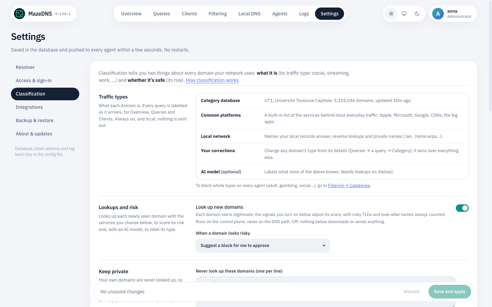

**How classification works**, opened from Settings → Classification or Filtering →
Review, explains the whole process: the order of the traffic-type sources, the path
from a query to a verdict, which service sees what, and how the score is built.

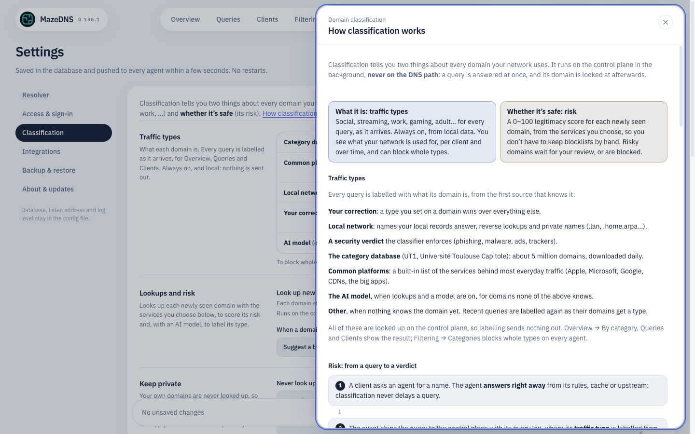

In short, the score starts at 85. Domains on the trusted list (and CDN
infrastructure) stay at 100. Otherwise risk factors subtract: threat feeds, a young
registration, risky TLDs, look-alike or random names, hosting platforms, suspended
registrations, reputation flags and the AI model. Trust evidence adds back: an old
registration, the company's own nameservers, registry locks, clean reputation. A
domain becomes a block candidate only below **50** *and* with a real threat signal,
so a young but legitimate site is never blocked on its shape alone.

### Review

**Filtering → Review** lists the domains the classifier scored, under **To check**
(block candidates waiting for you), **Auto-blocked**, **Blocked by you**, **Allowed
by you** and **Clean**. For a candidate, **Block** enforces it on every agent,
**Allow** never blocks it and stops suggesting it, and **Dismiss** hides it this
once (it may be scored again and come back).
Open a domain to see why it scored as it did: every signal, the points it cost or
added, and its WHOIS data.

| Review | A domain's score |
|---|---|
| 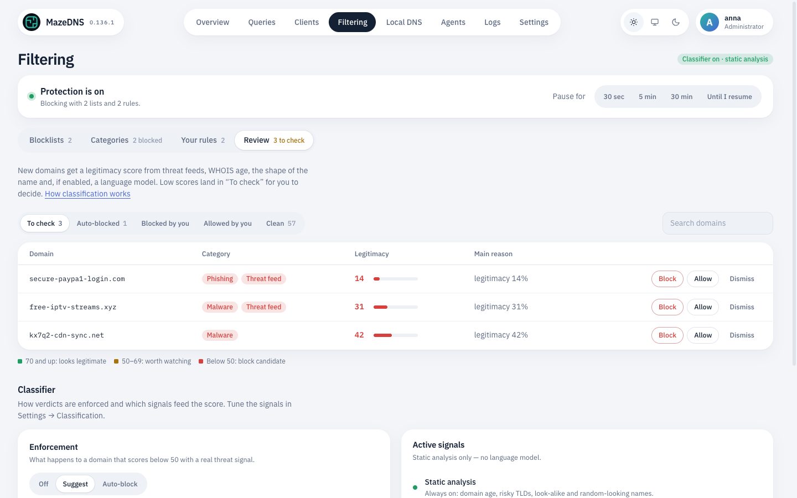 | 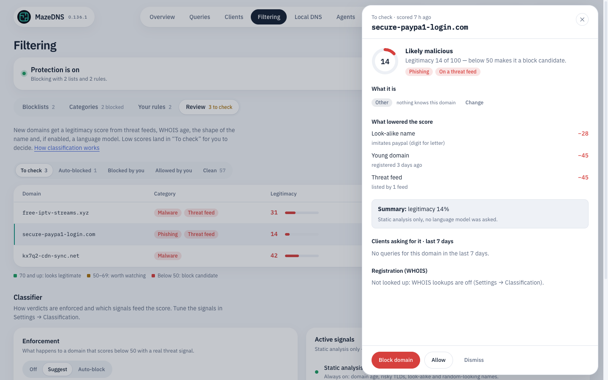 |

## Local DNS: local records

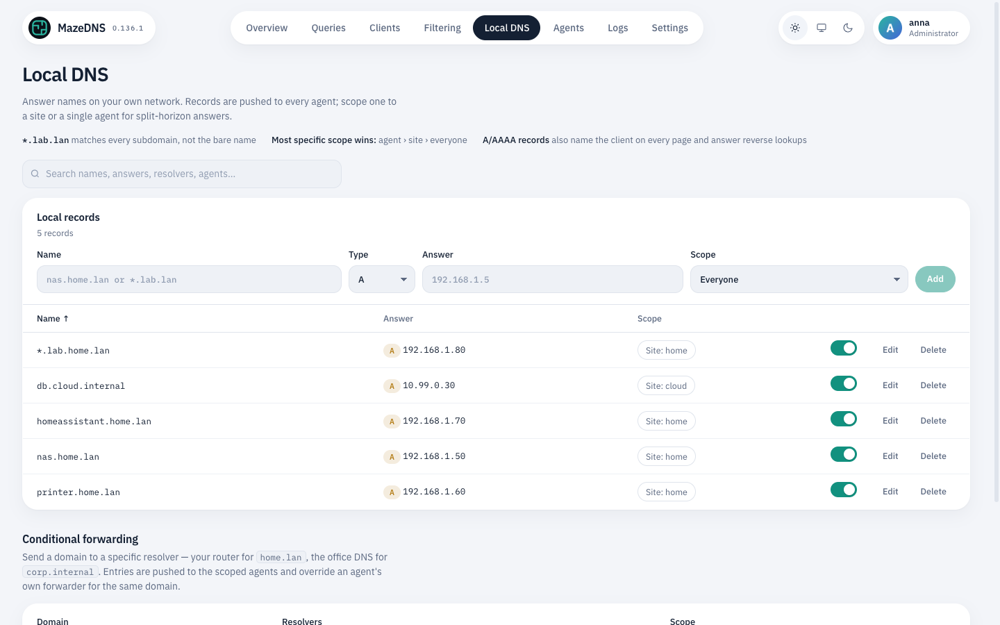

Add local answers (LAN hosts, split-horizon overrides) under **Local DNS →
Local records**. The API calls these entries *rewrites* (`/api/rewrites`), as
does the rest of this guide:

- Exact records — `nas.lan → A 10.0.0.5`, plus `AAAA` and `CNAME`.
- Wildcards — `*.lab.lan → A 10.0.0.9` answers every subdomain.

The most specific match wins (an exact record beats a wildcard). This also
holds across rewrites and conditional forwarders: a forwarder whose suffix
matches the queried name more specifically than a wildcard rewrite takes the
query (e.g. with `*.lab.lan → 10.0.0.9` and a forwarder for `ha.lab.lan`,
names under `ha.lab.lan` are forwarded, every other `*.lab.lan` name is
rewritten). An exact rewrite always wins, as does a tie.

Rewrites can be **scoped**: to every node (default), to specific nodes, or to
one or more sites. The same domain may carry different values under different
scopes — the classic split-horizon setup where `nas.home` resolves to a
different address per site. When several entries match a node, the most
specific wins (node > site > all); creating two entries that would tie at the
same specificity is rejected. Entries scoped to a node or site that no longer
exists are kept but match nothing (flagged with ⚠ in the UI).

Conditional forwarders, which route a whole domain to another resolver with the
same scoping, are under **Settings → Resolver**. Agents pick changes to either up
on their next config poll; the cluster page shows a per-node sync flag (⟳) until
each node has applied its own expected version.

The search box at the top of the page filters every list on it at once —
local records and each integration's section — by name, answer, record type,
scope target, or the integration that owns a record. Integration sections with no match are hidden while a
search is active.

### Reverse lookups (PTR) from rewrites

Exact `A`/`AAAA` rewrites also answer reverse lookups for their address:
with `nas.example.lan → A 192.0.2.10`, `dig -x 192.0.2.10 @<agent>` returns
`nas.example.lan` (`2001:db8::10` works the same through `ip6.arpa`). There is
nothing to configure:

- **Scoping** — each agent derives PTR answers from the rewrites it serves, so
  they follow the forward record's scope: a site-scoped rewrite answers reverse
  lookups only on that site's nodes. Disabled and wildcard rewrites imply no PTR.
- **Several names, one address** — a single PTR is returned, the preferred name:
  shortest, then alphabetical (`fs.example.lan` over `nas.example.lan` over
  `storage.example.lan`). One record keeps every client and cache on the same
  answer, and it is the same name the Clients page shows.
- **Conditional forwarders win** — if a conditional forwarder covers the
  reverse name (e.g. `2.0.192.in-addr.arpa`, or all of `in-addr.arpa`, sent to
  the DHCP server that owns your PTRs), the query is forwarded there and no PTR
  is synthesized: an explicit routing choice beats an implied record. Remove or
  narrow the forwarder to let rewrites answer. Authoritative zones from the
  config file also take precedence.
- Addresses with no matching rewrite, and other query types on reverse names,
  are forwarded as before. Forward answers are unchanged, including the
  `NODATA` for the address family a rewritten name has no record for.

### Records managed by an integration

An integration that pushes records (an IPAM sync, say) marks the rows it owns,
so it can reconcile them without touching yours. A rewrite has two more fields:

- `source` — the integration that owns it: a short slug of 1–32 lowercase
  letters, digits or dashes (`ipmaze`). Empty means a manual record.
- `external_id` — optional, the integration's own key for the object behind the
  record (`host:5b1e…`); MazeDNS doesn't interpret it. One source can't use the
  same `external_id` for two records of the same type, so the integration can
  find "its" record for an object without re-deriving the name. It needs a
  `source`.

Neither field changes how a record resolves, its scope, its PTR or the client
name it gives, and agents never see them: owning a record doesn't resync any
agent.

**API.** Every row of `GET /api/rewrites` carries both fields (`""` when
unset). `?source=ipmaze` lists only that integration's rows, `?source=` (empty)
only the manual ones. Writes check the owner, and refuse with **409** when it
doesn't match; the 409 body names the row in the way (`id`) and its owner
(`source`, `""` = manual):

- `POST /api/rewrites` with `source` (and `external_id`) adds the record, or
  updates the one with the same name, type and scope **if it has the same
  source**. Any other owner is a 409 (`a manual rewrite already serves
  nas.example.lan A`), so a sync never takes over a manual record and a manual
  add never takes over a synced one. A sync's update keeps the record's
  enabled switch as it is.
- `PUT /api/rewrites/{id}` changes the value or scope only when the body names
  the row's `source` (none for a manual row). The **enabled switch belongs to
  the operator**: changing only `enabled` works without the source. A sync must
  send back the current `enabled`, so it never turns on a record someone
  switched off.
- `DELETE /api/rewrites/{id}?source=ipmaze` deletes an owned row; a manual row
  is deleted without the parameter.
- `POST /api/rewrites/{id}/detach` (admin) clears `source` and `external_id`:
  the record becomes manual, and the integration meets it as a conflict from
  then on.

This guards against mistakes, not against a hostile caller: who may write at
all is decided by the token's role ([API tokens](#api-tokens)).

**Console.** **Local records** lists only the manual records. Each integration
that owns records gets its own section below it, **Synced from <source>**. There
a record can only be switched on or off: instead of Edit and Delete it has a
**Detach** button, which moves it to the local records.

## Client names

Wherever a client IP is shown (Overview, Queries, Clients, domain drill-downs)
the UI labels it with a name, taking the first source that knows the IP:

1. **static** — a hostname you assigned on the client's detail view (Clients tab).
2. **rewrite** — the name of an enabled, non-wildcard `A`/`AAAA` rewrite pointing
   at the IP. When several rewrites point at it, the shortest name (then
   alphabetical) is shown and the others appear in the tooltip (the badge reads
   `rewrite +N`). With scoped rewrites, the ones served by the node that handles
   the client win; if that node serves none for the IP, any enabled rewrite
   naming it is used. Rewrite changes rename clients immediately.
3. **reverse DNS** — a PTR lookup, for private addresses against the reverse-DNS
   resolver configured for the client's node, otherwise against the system
   resolver (cached for an hour, ten minutes when there is no PTR). Pointing that
   resolver at an agent also picks up the PTRs agents synthesize from rewrites
   (see above).

Rewrites come before reverse DNS because they are your own configuration and
cost no network query.

## Pause blocking

A one-click control temporarily suspends blocking for N minutes across the cluster
— handy when a blocked domain breaks something and you're diagnosing it. Allow,
rewrite, cache, and forwarding are unaffected; blocking resumes automatically.

## Clustering operations

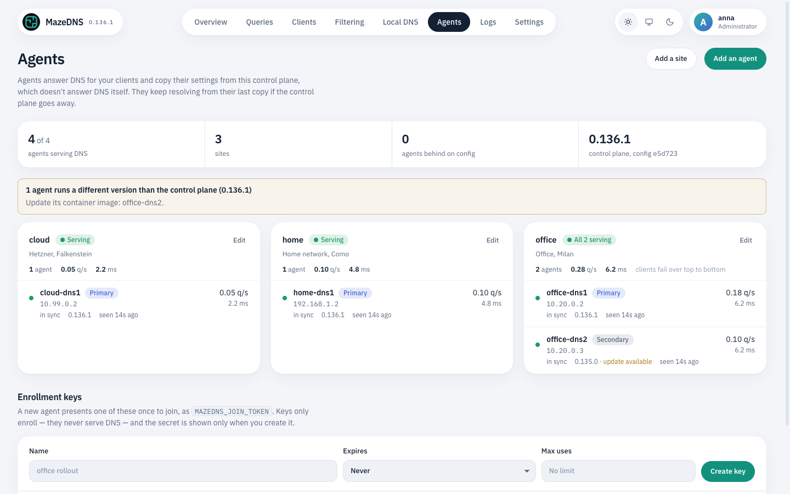

The control plane is the source of truth; each agent pulls rules + rewrites over an
authenticated snapshot and applies them live. The control plane never answers DNS,
so its dashboard/classifier load can't affect resolver latency.

- **Enrollment** — agents self-register with an **enrollment key** (created under
  Agents → Enrollment keys, passed as `MAZEDNS_JOIN_TOKEN`) and appear in the
  **Agents** page automatically, no key to copy. Toggle **require approval**
  (setup wizard, or Settings → Access → Cluster policy) to hold new agents until you
  approve them there — `MAZEDNS_REQUIRE_APPROVAL` only seeds this on first boot.
- **Per-node keys** — issued automatically when an agent enrolls with a key, and
  rotated by the control plane. You can also issue one manually on the Agents page
  (used via `MAZEDNS_NODE_KEY`). An agent whose key was *rotated* re-attaches to the
  same node by itself; a *revoked* node is refused at re-enrollment until you
  un-revoke it (see [install.md](install.md#removing-an-agent-revoke-vs-remove-only)).
- **Sites** — group agents by site, each with a role, and edit a site's name and
  description in place. Scoped records and forwarders target sites.
- **Node health** — the Agents page shows each node's address, status, version,
  sync state and counters; open an agent for its details.

  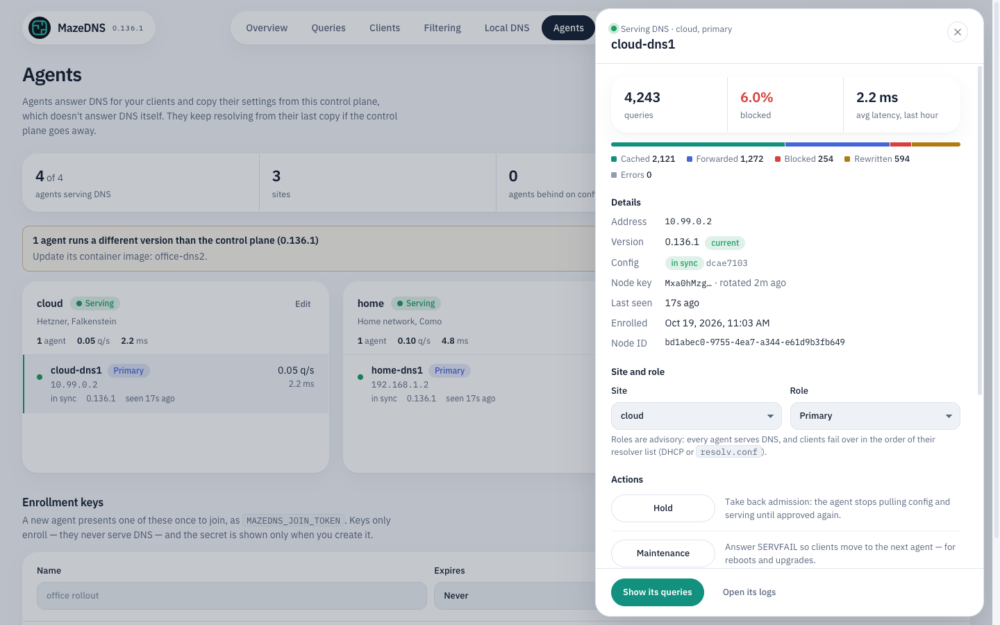
- **Maintenance/drain** — put a node into maintenance to answer `SERVFAIL` so clients
  fail over to another server while you work on it.
- **Removing agents** — *Remove & revoke* tombstones the node so the still-running
  agent can't rejoin; *Remove only* lets it re-enroll as a new node. Revoked agents
  are listed in a collapsible panel where you can *Un-revoke* (the agent may rejoin
  as a new node) or *Delete forever* (permanently remove the record — rejoining
  would still need a valid enrollment key).
- **Logs** — the **Logs** page shows recent process logs from the control plane and
  every agent (admin only). Agents ship new lines with their config poll, so agent
  logs can lag by up to ~30s. Logs are kept in a bounded in-memory buffer — history
  is lost on restart; use VictoriaLogs export for durable, searchable query logs.

  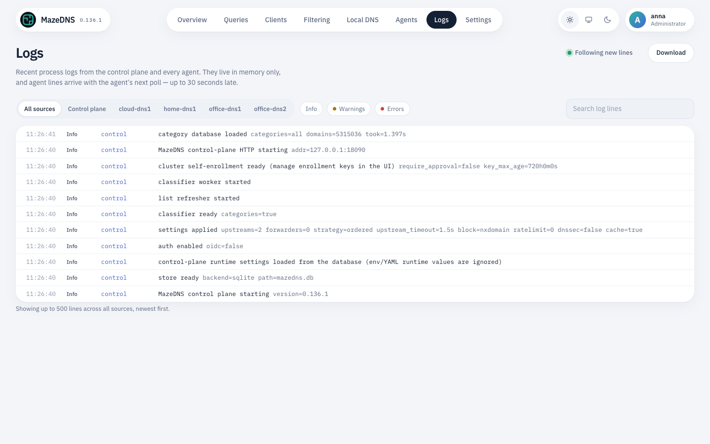

Create enrollment keys with an expiry and a maximum number of uses; the full secret
is shown once and then stored hashed. A revoked, expired or exhausted key can be
*Deleted* for good (audit-logged); an active key must be revoked first, and the
deprecated `join_token` can't be deleted while it is still in the config, since
every boot would import it again as an active key. Multisite networking (e.g. a WireGuard mesh so
agents reach the control plane privately) is up to you; see
[install.md](install.md#reaching-the-control-plane-from-an-agent) for pinning the
control plane's IP when an agent can't resolve its FQDN.

## Authentication and SSO

The UI and API require login by default. On first run the control plane opens a
setup wizard where you create the first admin (or configure SSO) — there are no
`MAZEDNS_ADMIN_*` env vars. Lost the password? Reset it with the
`control-plane reset-admin` CLI. Passwords are argon2id-hashed and sessions are
server-side and revocable. Roles: **admin** (full) and **readonly** (GET only).

Configure single sign-on in the setup wizard or later under **Settings → Access &
sign-in**: paste the issuer URL, client ID/secret, and the admin email or group. You can
map a provider group to admin, force SSO-only login, or auto-redirect to the
provider. The redirect URI must match your provider's registration exactly — the UI
shows the exact value to register, and it's logged at startup so you can compare.
(The `MAZEDNS_OIDC_*` variables still exist, but they only **seed** the database on
first boot and are ignored afterwards — see
[configuration.md](configuration.md#control-plane).)

## Your account, profile picture and theme

**Account** (your avatar, top right) holds your profile and password and, for
admins, **People**: who can sign in, with which role.

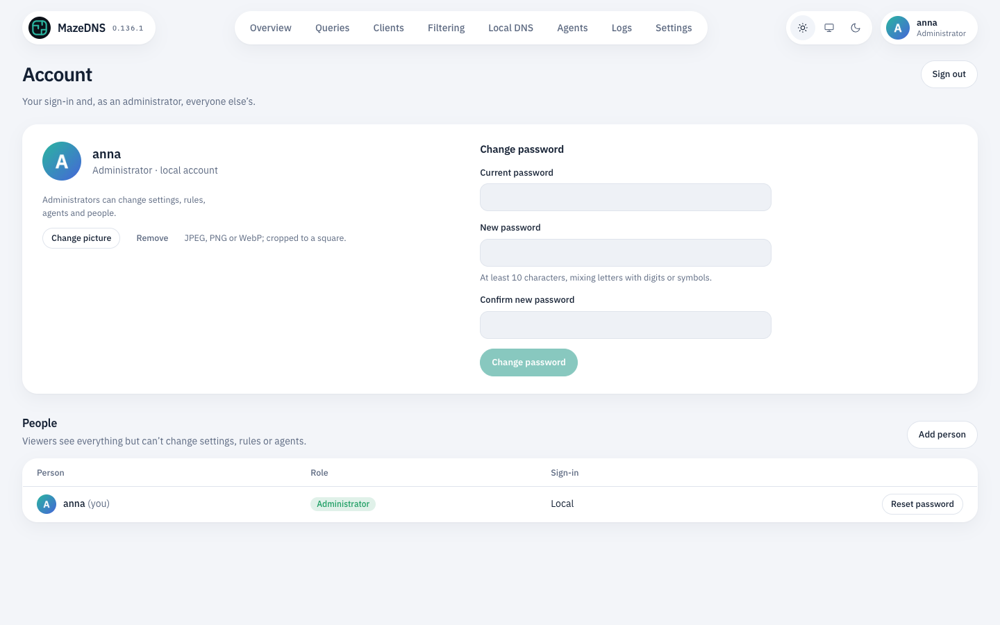

- **Profile picture.** Upload a JPEG, PNG or WebP (cropped to a square and resized
  in the browser) or remove it.
  Local accounts can always upload. SSO accounts show the identity provider's
  picture; an admin decides whether they may replace it with **Let SSO users
  replace their picture** under Settings → Access & sign-in.
- **Theme.** The three buttons next to your avatar pick light, **system** (follows
  your device's setting as it changes) or dark. The choice is kept in your
  browser.

## API tokens

Integrations, such as an IPAM that pushes its hosts as rewrites, call the API with
an **API token** instead of a user's password. Create one under **Settings →
Access & sign-in → API tokens**: give it a name that says what it is for, a role
(**readonly** or **admin**) and an optional expiry. The token (`mzd_…`) is shown
**once**; only a hash is stored. Send it as a bearer header:

```bash
TOKEN=mzd_…   # paste the token shown at creation

# list rewrites (readonly or admin)
curl -H "Authorization: Bearer $TOKEN" https://dns.example.internal/api/rewrites

# add or update a rewrite (admin)
curl -H "Authorization: Bearer $TOKEN" -H "Content-Type: application/json" \
  -d '{"domain":"nas.lan","rrtype":"A","value":"10.0.0.5"}' \
  https://dns.example.internal/api/rewrites
```

An integration that syncs records should mark them as its own with `source`; see
[Records managed by an integration](#records-managed-by-an-integration).

- **What a token can do:** whatever its role allows on DNS data: rewrites,
  forwarders, rules, lists, clients, resolver settings and the read-only views.
- **What it can never do, whatever its role:** manage users, API tokens, your
  own password, SSO / sessions / login settings, the metrics scrape token,
  credentials for integrations (classifier and its connection test,
  metrics/log export),
  config backup and restore, or cluster nodes, sites and enrollment keys. Those
  answer **403** to a token and need a console sign-in.
- **SSO-only mode** has no effect on tokens: it only disables password login.
- **A token never outranks the admin who created it.** If that admin is
  demoted to readonly, their admin tokens act as readonly (the list shows
  "Acts as a viewer"); deleting their account revokes their tokens for good
  (re-creating an account with the same name doesn't revive them). Removing
  someone's access therefore also removes it from any token they kept a copy of.
  For a long-lived integration, create its token from an account that will stay.
- **SSO accounts:** MazeDNS learns an SSO user's role from the provider only
  when they sign in. A demotion at the provider reaches their tokens at their
  next sign-in, and disabling them at the provider doesn't reach MazeDNS at all.
  To cut someone off at once, delete their account under **Account → People**.
- **Revoke** a token from the same list. It stops working on the next request.
  The list shows each token's role, last use (updated at most once a minute) and
  expiry, never its value.
- **Revocation and expiry** also close a live query-log stream opened with the
  token, within 15 seconds.
- A request with an `Authorization: Bearer mzd_…` header is judged on that
  token only: an invalid or revoked token gets **401**, even if the same client
  also sends a session cookie. Any other `Authorization` header (`Basic`, or a
  `Bearer` JWT that an authenticating proxy such as oauth2-proxy forwards) is
  ignored, and the session cookie decides as before.
- Tokens need authentication to be enabled: there is no account to tie them to
  otherwise.
- Creating and revoking tokens is recorded in the settings audit log, under the
  admin who did it. Changes to DNS data (rewrites, rules, …) have no change log
  yet, whoever makes them; where a token's action is recorded, it appears as
  `token:<name>`.

## Backup and restore

**Settings** can export the full mutable config — settings, rules, and
rewrites — as one versioned JSON bundle, and import it back. Import has two modes:
`merge` (upsert on top of what's there) and `replace` (clear rules and rewrites
first). A restore applies settings live, reloads the filtering policy, and bumps the
cluster config version so agents re-sync. The bundle omits users/sessions, the query
log, and per-node cluster keys. Rewrites keep their `source` and `external_id`: a
restored record wins over the one it replaces, owner included.

From the command line against the control plane:

```bash
curl -s http://<control-plane-host>:8080/api/config/export -o mazedns-config.json
curl -s -X POST 'http://<control-plane-host>:8080/api/config/import?mode=replace' \
  -H 'Content-Type: application/json' --data-binary @mazedns-config.json
```

(Send your session cookie/credentials if auth is enabled.)

## About and updates

**Settings → About & updates** shows the version the control plane runs, whether a
newer release is out (checked against GitHub releases every 6 hours, or on
**Check now**) and the
changelog of every release in between, plus the version each agent runs. Set
`MAZEDNS_UPDATE_CHECK=off` to stop the check, for example on a host without
internet access.

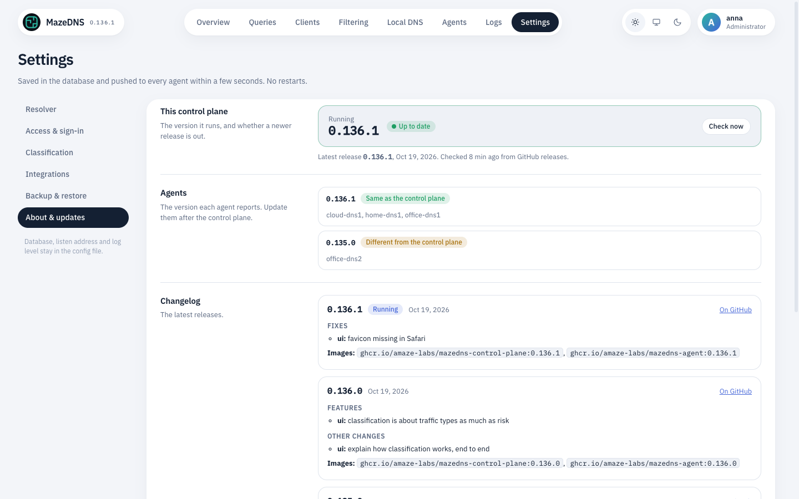

## On a phone or tablet

The UI adapts to phones and tablets: on a phone, the main pages sit in a tab bar at
the bottom and the rest under **More**.

| Overview | More | Agents |
|---|---|---|
| 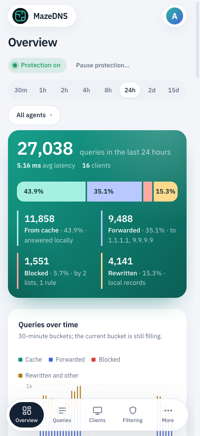 | 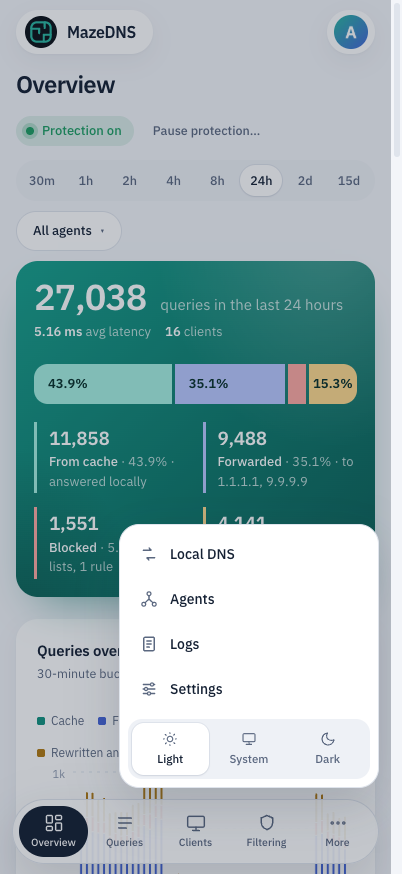 | 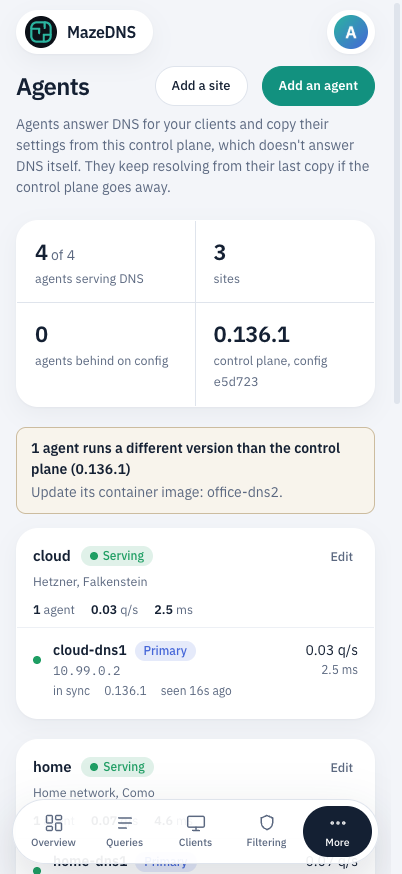 |

## Seeing real client IPs

The resolver reports each query's source IP as seen on the wire. When you publish
the DNS port through Docker's NAT (`-p 53:53`), the source is rewritten to the Docker
gateway, so per-client stats collapse to one client. To preserve real client IPs:

- **Docker (Linux):** run the agent with `network_mode: host` — see
  [install.md](install.md#real-client-ips-and-node-ips-host-networking).
- **Kubernetes:** give the DNS pod `hostNetwork: true`, or expose it via a Service
  with `externalTrafficPolicy: Local`.
- **Docker Desktop (macOS/Windows):** the VM can't pass the original client IP
  through NAT — expect a single collapsed client there.

For host-level DNS latency tuning (UDP buffers, conntrack), see
[troubleshooting.md](troubleshooting.md).
